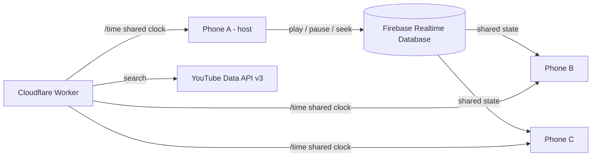

# UNISONE

**The Sound of Togetherness.**

Play the same YouTube song on every phone, at the same moment. Start a room, share the code, press play.

**Live:** https://unisone.vercel.app

---

## Features

**Listening together**
- Create a room and share it with a native Share button (WhatsApp, Telegram, Instagram and more). The link opens the site and takes friends straight to the invite card for that room.
- Search YouTube from inside the app, or paste any YouTube link.
- Shared queue. Drag a song by its grip handle to reorder it; playback follows the new order.
- Tight multi-device sync: a shared clock, per-device start-delay learning and gentle drift correction.

**Host controls**
- Maximum number of listeners.
- Who can play, pause and skip: only the host, chosen people, or everyone.
- Whether everyone can add songs.
- Approve new people before they join, and lock the room.
- Remove people. Hand the room over to someone else when the host leaves.

**Experience**
- Own custom player UI. YouTube's chrome (title bar, share, logo, end-screen suggestions) is hidden.
- Spotify-style search: the player shrinks into a mini bar, and tapping it brings the player back.
- Screen stays awake while you are in a room (Wake Lock API, where supported).
- A listener without control permission can pause and resume just for themselves, and rejoins the shared timeline instantly.
- Mobile first. No page zoom, no accidental text selection, fixed header and footer.

---

## How it works



Every phone plays through YouTube's official IFrame Player. The app never extracts or downloads audio.

### Sync in detail

1. **Shared state.** A controller's action is written to `rooms/{code}/state` as `{ cur, playing, pos, at }`: song key, whether it is playing, the position in seconds, and the shared-clock time at which that position holds.
2. **Shared clock.** Each phone makes 8 quick round trips to the Worker's `/time` endpoint and keeps the fastest. All phones therefore agree on the time to within a few tens of milliseconds. Firebase's own server time offset is used as a fallback.
3. **Scheduled start.** Play and resume are scheduled 450 ms ahead, and a new song 1800 ms ahead, so every phone can get ready and start on the same beat.
4. **Start-delay learning.** Each phone measures how long it takes from `playVideo()` to actually playing, stores that locally, and starts that much earlier next time.
5. **Drift correction** (every second):
   - within 0.12 s: nothing to do
   - up to 1.2 s: briefly play at 1.25x or 0.75x speed, with no seek and no stutter
   - above 1.2 s: one seek, at most every 2.5 s
6. **No disruption.** A new joiner loads the song and jumps to the right position on their own device. Phones that are already in sync are left alone.

No web player can be perfectly sample-accurate. Expect agreement in the tens to low hundreds of milliseconds, and the header pill shows the measured offset.

---

## Tech stack

| Part | Technology |
| --- | --- |
| Frontend | Single `index.html`: vanilla HTML, CSS and JavaScript (ES module). No build step. |
| Playback | YouTube IFrame Player API |
| Realtime and auth | Firebase Realtime Database and Anonymous Authentication (JS SDK 13.0.0 from the Google CDN) |
| Search and shared clock | Cloudflare Worker (`worker.js`) |
| Hosting | Vercel (static) |

---

## Repository layout

```
index.html              The whole app (UI, logic, styles)
worker.js               Cloudflare Worker: YouTube search proxy and /time clock
database.rules.json     Firebase Realtime Database security rules
dev.jpg                 Developer photo shown on the About card
og.png                  Link-preview image (WhatsApp, Telegram and others)
README.md
```

---

## Database structure

```
rooms/{CODE}/
  host            uid of the host
  createdAt       timestamp
  settings/       max, control (host | selected | everyone), approve, locked, add
  members/{uid}/  name, joinedAt, dj (can control playback)
  queue/{key}/    id, title, author, ord (sort order)
  state/          cur, playing, pos, at
  requests/{uid}/ name (people waiting for approval)
  kicked/{uid}    "kicked" or "denied"
```

The security rules in `database.rules.json` enforce who may control playback, add or remove songs, change settings, remove people, and change the host. Room codes cannot be listed; you must know the code.

---

## Setup

### 1. Firebase

1. Create a project at https://console.firebase.google.com.
2. **Authentication** -> Sign-in method -> enable **Anonymous**.
3. **Realtime Database** -> Create database (pick a nearby region) -> start in locked mode.
4. **Realtime Database** -> **Rules** -> paste the contents of `database.rules.json` -> **Publish**.
5. **Authentication** -> Settings -> **Authorized domains** -> add your site domain (`localhost` is there by default).
6. **Project settings** -> Your apps -> Web app -> copy the `firebaseConfig` into the top of the script in `index.html`.

### 2. Cloudflare Worker (search and clock)

1. Create a Google Cloud project, enable **YouTube Data API v3**, and create an API key restricted to that API only.
2. In Cloudflare, create a Worker and paste in `worker.js`.
3. Under **Settings -> Variables and Secrets** add:
   - Secret `YT_API_KEY`: your YouTube API key
   - Variable `ALLOWED_ORIGINS`: comma-separated sites allowed to call the Worker, for example `https://unisone.vercel.app,http://localhost:5500`
4. Deploy, then set `CONFIG.SEARCH_URL` in `index.html` to the Worker URL (keep the trailing `/`).

Search uses 100 quota units per request and the default daily quota is 10,000, so about 100 searches a day. Results are cached for 24 hours. When the quota runs out, the app asks users to paste a link instead.

### 3. Deploy

Push to GitHub and import the repository in Vercel (Framework Preset: **Other**). Then:
- Add the Vercel domain to the Worker's `ALLOWED_ORIGINS` and to Firebase **Authorized domains**.
- Update the `og:url` and `og:image` meta tags in `index.html` if your domain differs from `unisone.vercel.app`.

### Run locally

Serve the folder over HTTP (opening the file directly will not work):

```
npx serve
```

Add the local address (for example `http://localhost:3000`) to the Worker's `ALLOWED_ORIGINS`.

---

## Security notes

- The Firebase web `apiKey` is a public project identifier, not a secret. GitHub's secret scanner will flag it; that alert can be closed as a false positive. To limit abuse, restrict that key to your website in Google Cloud (Application restrictions -> Websites).
- The **YouTube API key** is the real secret. It lives only in the Worker's `YT_API_KEY` secret. Never commit it.
- Keep Firebase Anonymous Auth and the published rules in place. The rules, not the UI, decide what each person is allowed to do.

---

## Known limitations

- **Maximum listeners** is enforced by the host's device, because Firebase rules cannot count children. If the host's phone is off, the limit is not enforced. Strict enforcement would need a server (for example Cloud Functions).
- Moving to the next song when one ends is done mainly by the host's device. If it sleeps, the next song may not start.
- Some browsers, notably on iPhone, block automatic playback. A "Tap to join the music" button appears when that happens. Wake Lock needs a recent browser (iOS 16.4 or later).
- YouTube ads inside an embedded player can briefly unsettle one phone; drift correction recovers.
- Videos whose owners disable embedding cannot be played.
- The mini player and the hidden YouTube interface differ from YouTube's default presentation. Review YouTube's API Services Terms and Developer Policies before launching this publicly or commercially.

---

## Developer

**Pallab Ghosh**

- Portfolio: https://zenix-pallab.netlify.app
- GitHub: https://github.com/zenix-pallab
- Instagram: https://www.instagram.com/zenix_pallab
- X: https://x.com/zenix_pallab
- Facebook: https://www.facebook.com/share/18Mc2tV4Ag/
- Linktree: https://linktr.ee/zenix_pallab
- Email: zenix.pallab@gmail.com

---

## License

No license has been chosen yet. Add a `LICENSE` file before accepting outside contributions. All songs and videos belong to their creators and are played through YouTube's official player.
