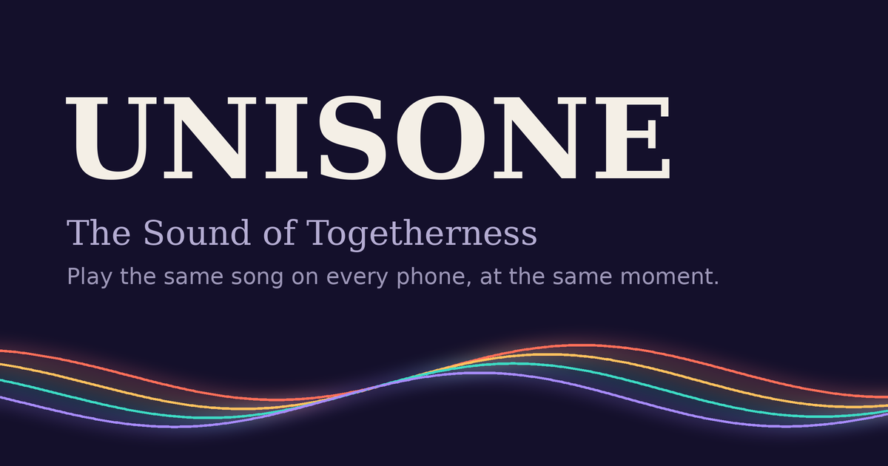
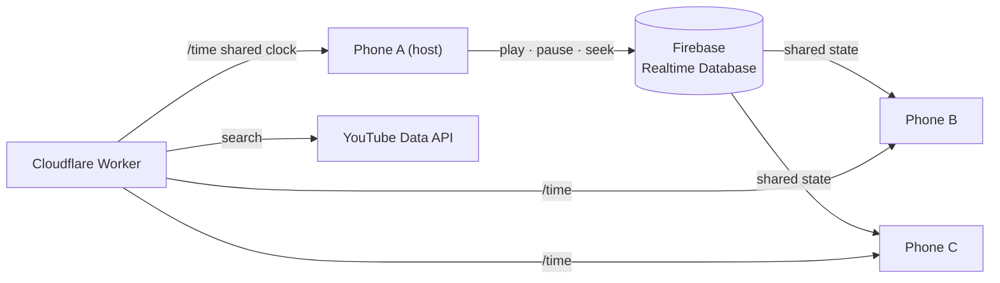

<p align="center">
  
</p>

<p align="center">
  
</p>

<h1 align="center">UNISONE</h1>

<p align="center"><b>The Sound of Togetherness</b></p>

<p align="center">
  Play the same YouTube song on every phone, at the same moment.<br>
  Start a room, share the code, press play.
</p>

<p align="center">
  <a href="https://unisone.vercel.app"><b>Open UNISONE</b></a>
  &nbsp;·&nbsp;
  <a href="CHANGELOG.md">Changelog</a>
  &nbsp;·&nbsp;
  <a href="#developer">Developer</a>
</p>

<p align="center">
  
  
  
  
  
</p>

---

## Highlights

<table>
  <tr>
    <td width="33%" valign="top">
      <b>Listen together</b><br><br>
      Rooms with a six-character code<br>
      Invite links that open the room directly<br>
      YouTube search or paste any link<br>
      Shared queue with drag-to-reorder<br>
      Tight sync across devices
    </td>
    <td width="33%" valign="top">
      <b>Stay in control</b><br><br>
      Choose who can play, pause and skip<br>
      Approve newcomers or lock the room<br>
      Set a listener limit<br>
      Hand the room over when you leave<br>
      Automatic host failover
    </td>
    <td width="33%" valign="top">
      <b>Made for phones</b><br><br>
      Spotify-style search with a mini player<br>
      Screen stays awake in a room<br>
      Dim mode: black screen, music keeps playing<br>
      Rejoins your room after the screen sleeps<br>
      Smooth, touch-first interface
    </td>
  </tr>
</table>

---

## How it works



Every phone plays through YouTube's official IFrame Player. UNISONE never extracts or downloads audio.

### Staying in sync

| Step | What happens |
| --- | --- |
| **Shared state** | A controller's action is stored as `{ cur, playing, pos, at }`: the song, whether it is playing, the position, and the shared-clock time at which that position holds. |
| **Shared clock** | Each phone makes 8 quick round trips to the Worker's `/time` endpoint and keeps the fastest, so all phones agree on the time within a few tens of milliseconds. |
| **Scheduled start** | Play and resume are scheduled 450 ms ahead, a new song 1800 ms ahead, so every phone starts on the same beat. |
| **Start-delay learning** | Each phone measures how long it takes from `playVideo()` to actual playback and starts that much earlier next time. |
| **Drift correction** | Within 0.12 s nothing happens. Up to 1.2 s the phone briefly plays at 1.25× or 0.75× speed, with no seek and no stutter. Beyond that, a single seek. |
| **Undisturbed listening** | A newcomer loads the song and jumps to the right position on their own device. Phones already in sync are left alone. |

Web players cannot be sample-accurate. Phones typically agree within tens to low hundreds of milliseconds, and the pill in the header shows the measured offset.

---

## Tech stack

| Layer | Technology |
| --- | --- |
| Interface | One `index.html`: vanilla HTML, CSS and JavaScript (ES module), no build step |
| Playback | YouTube IFrame Player API |
| Realtime and identity | Firebase Realtime Database and Anonymous Authentication |
| Search and shared clock | Cloudflare Worker (`worker.js`) |
| Hosting | Vercel (static) |

---

## Project structure

```
.
├── index.html            the whole app: interface, logic and styles
├── worker.js             Cloudflare Worker: YouTube search proxy and /time clock
├── database.rules.json   Firebase Realtime Database security rules
├── logo.svg              logo
├── favicon.svg           favicon
├── favicon.png           favicon fallback and touch icon
├── dev.jpg               developer photo for the About card
├── og.png                link-preview image
├── robots.txt            search-engine rules
├── sitemap.xml           search-engine sitemap
├── google4bac51bffc979ddf.html   Search Console site verification
├── README.md
└── CHANGELOG.md
```

---

## Getting started

### 1. Firebase

1. Create a project in the [Firebase console](https://console.firebase.google.com).
2. **Authentication** → Sign-in method → enable **Anonymous**.
3. **Realtime Database** → Create database → start in locked mode.
4. **Realtime Database** → **Rules** → paste `database.rules.json` → **Publish**.
5. **Authentication** → Settings → **Authorized domains** → add your site's domain.
6. **Project settings** → Your apps → Web app → copy the `firebaseConfig` into the top of the script in `index.html`.

### 2. Cloudflare Worker

1. In Google Cloud, enable **YouTube Data API v3** and create an API key restricted to that API.
2. In Cloudflare, create a Worker and paste in `worker.js`.
3. Add under **Settings → Variables and Secrets**:

| Name | Type | Value |
| --- | --- | --- |
| `YT_API_KEY` | Secret | your YouTube Data API key |
| `ALLOWED_ORIGINS` | Variable | comma-separated sites allowed to call the Worker, e.g. `https://unisone.vercel.app,http://localhost:3000` |

4. Deploy, then set `CONFIG.SEARCH_URL` in `index.html` to the Worker's URL, keeping the trailing `/`.

Search costs 100 quota units per request against the default 10,000 per day, which is about 100 searches a day. Results are cached for 24 hours, and when the quota is used up the app asks people to paste a link instead.

### 3. Deploy

Push the repository to GitHub and import it in [Vercel](https://vercel.com) with the **Other** framework preset. Add the Vercel domain to the Worker's `ALLOWED_ORIGINS` and to Firebase's authorized domains.

### Run locally

Serve the folder over HTTP:

```bash
npx serve
```

Open the printed address and add it to the Worker's `ALLOWED_ORIGINS`.

### Configuration at a glance

| Setting | Where |
| --- | --- |
| Firebase project | `firebaseConfig` at the top of the script in `index.html` |
| Search and clock endpoint | `CONFIG.SEARCH_URL` in `index.html` |
| YouTube API key | `YT_API_KEY` secret in the Worker |
| Allowed sites | `ALLOWED_ORIGINS` variable in the Worker |
| Link preview | `og:` tags in the `<head>` of `index.html` |

---

## Data model

```
rooms/{CODE}/
├── host              uid of the host
├── lastSeen          when someone was last in the room
├── settings/         max, control (host | selected | everyone), approve, locked, add
├── members/{uid}/    name, joinedAt, dj
├── seen/{uid}        phones that have been admitted before
├── queue/{key}/      id, title, author, ord
├── state/            cur, playing, pos, at
├── requests/{uid}/   name
└── kicked/{uid}      "kicked" or "denied"
```

The security rules decide who may control playback, add or remove songs, change settings, remove people and change the host. Rooms cannot be listed; you need the code.

---

## Good to know

- The listener limit is enforced by the host's phone, because database rules cannot count members.
- The next song after a track ends is started mainly by the host's phone.
- Some browsers, notably on iPhone, block automatic playback. A **Tap to join the music** button appears when that happens.
- Audio cannot play with the screen locked inside a web page. **Dim mode** keeps the screen on behind a black cover instead.
- Videos whose owners disable embedding cannot be played.

---

## Developer

<table>
  <tr>
    <td valign="middle"><b>Pallab Ghosh</b></td>
    <td valign="middle">
      <a href="https://zenix-pallab.netlify.app">Portfolio</a> ·
      <a href="https://github.com/zenix-pallab">GitHub</a> ·
      <a href="https://www.instagram.com/zenix_pallab">Instagram</a> ·
      <a href="https://x.com/zenix_pallab">X</a> ·
      <a href="https://www.facebook.com/share/18Mc2tV4Ag/">Facebook</a> ·
      <a href="https://linktr.ee/zenix_pallab">Linktree</a> ·
      <a href="mailto:zenix.pallab@gmail.com">Email</a>
    </td>
  </tr>
</table>

---

<p align="center">
  <br>
  <sub>Made with care by Pallab Ghosh · Songs play through YouTube's official player</sub>
</p>
